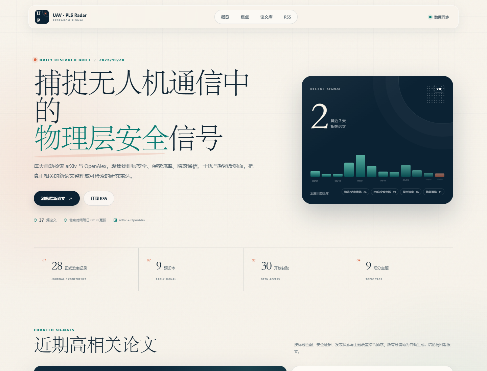

# UAV · PLS Radar

物理层安全 × 无人机通信方向的每日论文雷达。


系统每天自动检索公开论文元数据，完成主题筛选、去重、相关性排序和中文自动导读，生成可搜索的静态网页，并可通过企业微信机器人或微信通知服务推送。

## 当前能力

- 数据源：OpenAlex；arXiv 可用时自动合并
- 默认时间窗：最近 90 天，保留最多 400 天历史
- 相关性闸门：必须同时命中无人机主题和物理层安全核心证据
- 去重：DOI、arXiv ID、规范化标题
- 页面功能：全文搜索、发表类型筛选、主题筛选、排序、加载更多、RSS
- 推送：企业微信机器人、PushPlus、Server酱，三者可选其一或同时启用
- 部署：GitHub Actions + GitHub Pages
- 定时：每天北京时间 06:30

> 自动导读是规则生成的研究线索，不是论文翻译，也不会替代原文结论。

## 本地预览

需要 Node.js 22 左右版本。

```powershell
cd outputs\uav-pls-daily
node scripts/fetch-papers.mjs
node scripts/validate-data.mjs
node scripts/serve.mjs
```

浏览器打开：

```text
http://127.0.0.1:4173
```

如果当前网络无法连接 arXiv，可以让任务只使用 OpenAlex：

```powershell
$env:SKIP_ARXIV='1'
node scripts/fetch-papers.mjs
```

抓取器连续两次无法访问 arXiv 时也会自动降级，不会中断 OpenAlex 流程。

## 微信推送

### 方案 A：企业微信机器人（推荐）

1. 打开企业微信群，添加“群机器人”。
2. 复制机器人 Webhook 地址。
3. 在 GitHub 仓库添加 Actions Secret：`WECOM_WEBHOOK_URL`。
4. 同时添加 `SITE_URL`，例如 `https://your-name.github.io/uav-pls-daily`。

企业微信机器人 SendKey 不要写进代码或提交到 Git。

### 方案 B：PushPlus / Server酱

在 GitHub Actions Secrets 中选择配置：

- `PUSHPLUS_TOKEN`
- `SERVERCHAN_SENDKEY`

两者都支持个人微信接收，但属于第三方通知服务，长期使用前请确认其可用额度和服务条款。

### 本地测试推送内容

不配置任何密钥时，脚本只生成预览，不发送消息：

```powershell
node scripts/notify.mjs
Get-Content notification-preview.md
```

## 部署到 GitHub Pages

1. 新建一个 GitHub 仓库，把本目录作为仓库根目录推送。
2. 打开仓库 `Settings > Pages`，将 Source 设为 **GitHub Actions**。
3. 打开 `Settings > Secrets and variables > Actions`，添加：
   - `SITE_URL`：最终网页地址
   - `WECOM_WEBHOOK_URL`：企业微信机器人地址，可选
   - `PUSHPLUS_TOKEN`：可选
   - `SERVERCHAN_SENDKEY`：可选
4. 打开 `Actions > Daily UAV PLS brief > Run workflow` 手动运行一次。
5. 首次运行会生成最近 90 天的数据；之后每天 06:30 自动更新。

工作流位于 `.github/workflows/daily.yml`。生成的数据会提交回仓库，以保留 `firstSeenDate`，这样每日推送才能识别“今天新发现”的论文。

## 页面结构

```text
site/
├── index.html              静态日报页面
├── assets/styles.css       页面样式
├── assets/app.js           搜索、筛选和渲染逻辑
├── data.js                 页面内嵌数据
├── data.json               可供其他程序读取的数据
├── feed.xml                Atom/RSS 订阅
└── favicon.svg
```

直接双击 `site/index.html` 也可以离线查看，但建议用 `node scripts/serve.mjs` 启动本地服务测试完整行为。

## 调整检索范围

主要配置在 `config/topics.json`：

- `lookbackDays`：每次检索的时间窗
- `dailyLookbackDays`：通知回看天数
- `minRelevanceScore`：最低相关度
- `maxPapers`：页面最多保留论文数
- `arxiv.queries`：arXiv 查询式
- `openalex.queries`：OpenAlex 查询式
- `topicTags`：页面主题分类

检索引擎位于 `scripts/fetch-papers.mjs`：

- `UAV_TERMS`：无人机相关词
- `SECURITY_TERMS`：广义安全词
- `CORE_SECURITY_TERMS`：物理层安全核心证据
- `TAG_RULES`：主题标签规则

增加关键词后，建议先运行：

```powershell
$env:SKIP_ARXIV='1'
node scripts/fetch-papers.mjs
node scripts/validate-data.mjs
```

然后检查页面前 12 篇是否仍然聚焦目标方向。

## 推送策略

微信推送只发送相关度最高的前 5 篇，完整列表进入网页查看：

- 当天有新论文：推送“今日新增 N 篇”
- 当天没有新论文：推送近期高相关论文，并明确说明今日无新增
- 页面和 RSS 始终保留完整归档

## 数据与版权

本项目只聚合公开论文元数据与摘要，用于科研信息发现。论文全文、图表和正式版本版权归原作者及出版机构所有。页面链接回 arXiv、DOI 或开放获取页面，不复制付费全文。

`config/topics.json` 中的联系邮箱是占位值。正式运行前建议替换为你的真实联系邮箱，便于 OpenAlex 识别调用方。
